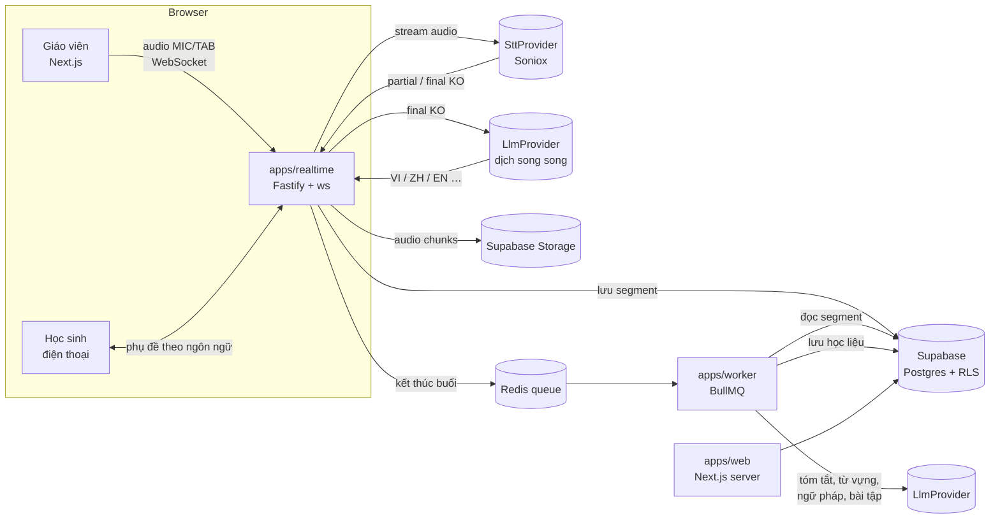

# Kiến trúc

Nguyên tắc chính: **nhận giọng tiếng Hàn một lần, dịch song song chỉ sang các ngôn ngữ đang có học sinh trong lớp.** Trình duyệt chỉ gửi audio và nhận kết quả; mọi lời gọi AI chạy ở server.

## Sơ đồ tổng thể



## Thành phần

| Thành phần | Trách nhiệm | Triển khai gợi ý |
| --- | --- | --- |
| `apps/web` | UI giáo viên + học sinh, API routes (lớp, buổi học, bài tập), xác thực Supabase | Vercel |
| `apps/realtime` | Phòng realtime theo `lessonId`; nhận audio, gọi STT, dịch final segment, phát cho học sinh, lưu DB | Fly.io / Railway, region gần Seoul |
| `apps/worker` | Job sau buổi học, tạo bài tập theo yêu cầu, dọn bản ghi hết hạn | Cùng nơi với realtime |
| Supabase | Auth Google, Postgres + RLS, Storage cho audio và ảnh slide | Supabase Cloud, region Seoul/Tokyo |
| Redis | Queue BullMQ, pub/sub giữa các instance realtime | Upstash |

## Luồng realtime (một buổi học)

1. Giáo viên bấm **Bắt đầu** → `POST /api/lessons` tạo lesson (`status = live`), trả về token phòng.
2. Trình duyệt giáo viên mở WebSocket tới `apps/realtime` cho **mỗi nguồn** (mic, tab). Audio: Opus hoặc PCM 16 kHz mono, gói 100–200 ms.
3. Realtime gateway mở stream tới STT, bật nhận diện ngôn ngữ tự động và tách người nói, kèm từ vựng bài học làm context.
4. Kết quả `partial` → phát ngay cho phòng (không lưu).
5. Kết quả `final` → lưu `segments` → gọi dịch song song sang `target_langs` của lớp → lưu `segment_translations` → phát cho học sinh theo ngôn ngữ của từng người.
6. Học sinh "Giữ để hỏi": audio ngắn → STT theo tiếng mẹ đẻ → dịch sang tiếng Hàn → lưu `questions` → đẩy cho giáo viên.
7. Kết thúc → lesson `status = processing` → đẩy job `lesson.finalize` vào queue.
8. Worker: tóm tắt, trích từ vựng/ngữ pháp kèm cấp TOPIK, tạo bài tập (JSON theo schema zod), dịch học liệu sang các ngôn ngữ của lớp → `status = review`.
9. Giáo viên duyệt → `status = published` → học sinh nhận thông báo.

### Giao thức WebSocket (`apps/realtime`)

Định nghĩa đầy đủ: `packages/shared/src/realtime.ts` (zod + kiểu TypeScript dùng chung cho trình duyệt và server).

- **Kết nối:** `${NEXT_PUBLIC_REALTIME_URL}/ws/lessons/<lessonId>`. Tin đầu tiên (trong 10 s) phải là `{ type: 'hello', token, role, source? }`, với `token` là access token Supabase của người dùng. Token gửi trong tin nhắn, không đặt trong URL.
- **Quyền:** gateway xác thực token với Supabase rồi kiểm tra trong database (service role): giáo viên của lớp hoặc thành viên lớp, đúng vai trò, buổi học đang `live`, và `source` có trong `lessons.sources`. Sai thì gửi `{ type: 'error', code }` rồi đóng với mã 44xx (`REALTIME_CLOSE`).
- **Âm thanh:** mỗi nguồn (`mic`, `tab`) của giáo viên là một kết nối riêng, gửi khung nhị phân PCM16 16 kHz mono, tối đa 64 KB mỗi khung. Mở kết nối thứ hai cho cùng nguồn sẽ đóng kết nối cũ (4408).
- **Phụ đề:** `partial` phát ngay, không lưu; `final` được đánh `seq` liên tục theo buổi học (tiếp nối sau khi kết nối lại), lưu `segments` rồi mới phát. Thời gian của câu tính theo mốc `started_at` của buổi học. Người vào muộn nhận 30 câu `final` gần nhất trong tin `ready`.
- **Điều khiển (giáo viên):** `pause` / `resume` (bỏ qua âm thanh khi tạm dừng, phát `status`), `end`: chốt các câu đang dở → `status = processing` → đẩy job `lesson.finalize` (`lessonFinalizeJobOptions` trong `packages/shared/src/jobs.ts`, mỗi buổi một job) → đóng mọi kết nối với mã 4000.
- **Sĩ số:** giáo viên nhận `{ type: 'presence', students }` mỗi khi học sinh vào hoặc ra.

### Ngân sách độ trễ

| Bước | Mục tiêu |
| --- | --- |
| Audio → gateway | < 150 ms |
| STT partial | < 600 ms |
| Final → dịch xong (mỗi ngôn ngữ, song song) | < 1,2 s |
| Gateway → học sinh | < 150 ms |

## Lớp nhà cung cấp

```ts
// packages/providers/src/stt.ts
export interface SttStream {
  write(chunk: ArrayBuffer): void;
  end(): Promise<void>;
  on(event: 'partial' | 'final', cb: (r: SttResult) => void): void;
  on(event: 'error', cb: (e: Error) => void): void;
}
export interface SttResult {
  text: string;
  lang: string;           // ISO 639-1, ví dụ "ko"
  speaker?: string;       // nhãn từ diarization
  startMs: number;
  endMs: number;
}
export interface SttProvider {
  openStream(opts: { languages: string[]; context?: string[]; diarize?: boolean }): Promise<SttStream>;
}

// packages/providers/src/llm.ts
export interface LlmProvider {
  translate(input: { text: string; from: string; to: string[]; glossary?: Record<string, string> }): Promise<Record<string, string>>;
  complete<T>(input: { system: string; prompt: string; schema?: ZodSchema<T> }): Promise<T>;
}
```

Adapter đặt trong `packages/providers/src/adapters/`. Chọn adapter qua biến môi trường `STT_PROVIDER`, `LLM_PROVIDER`. LLM dùng OpenAI (`openai.ts`: `translate` dùng `LLM_MODEL_FAST` và trả JSON theo từng mã ngôn ngữ; `complete` dùng `LLM_MODEL_QUALITY` với JSON schema sinh từ zod, kết quả được kiểm tra lại bằng zod). Adapter `mock` (mặc định): STT trả về các câu tiếng Hàn cố định, dịch trả `[vi] <câu gốc>`. Nhờ vậy có thể phát triển và chạy test khi chưa có khoá API. Realtime và worker kiểm tra cấu hình nhà cung cấp ngay khi khởi động.

## Mô hình dữ liệu (rút gọn)

| Bảng | Cột chính |
| --- | --- |
| `profiles` | `id` (= auth.users), `display_name`, `role` (`teacher` \| `student` \| `admin`), `mother_tongue`, `ui_lang` |
| `classes` | `id`, `teacher_id`, `name`, `level`, `schedule`, `textbook`, `invite_code` (unique), `settings` jsonb |
| `class_members` | `class_id`, `student_id`, `mother_tongue`, `joined_at` |
| `lessons` | `id`, `class_id`, `title`, `topic`, `textbook`, `format` (`room` \| `online` \| `hybrid`), `sources` (`mic` \| `tab`)[], `target_langs` text[] (tối đa 5), `display` (`bilingual` \| `korean_only` \| `hidden`), `status` (`live` \| `processing` \| `review` \| `published`), `started_at`, `ended_at`, `audio_path`. Mỗi lớp chỉ có một buổi `live` cùng lúc |
| `segments` | `id`, `lesson_id`, `seq`, `speaker_label`, `speaker_profile_id`, `source` (`mic` \| `tab`), `lang`, `text`, `start_ms`, `end_ms`, `edited` bool. Chỉ lưu câu `final`; `(lesson_id, seq)` duy nhất |
| `segment_translations` | `segment_id`, `lang`, `text` |
| `questions` | `id`, `lesson_id`, `student_id`, `orig_lang`, `orig_text`, `ko_text`, `status` (`open` \| `answered`), `pinned` |
| `vocab_items` | `id`, `lesson_id` / `class_id`, `ko`, `pos`, `topik_level`, `example_ko`, `segment_id` |
| `vocab_translations` | `vocab_id`, `lang`, `meaning` |
| `grammar_items` | `id`, `lesson_id`, `pattern`, `example_ko`, `note` + bảng dịch tương tự |
| `assignments` | `id`, `class_id`, `lesson_id`, `due_at`, `items` jsonb, `status` |
| `attempts` | `assignment_id`, `student_id`, `answers` jsonb, `score`, `submitted_at` |
| `saved_words` | `student_id`, `vocab_id`, `srs_state` jsonb |
| `usage_events` | `lesson_id`, `kind` (`stt_minutes` \| `llm_tokens`), `amount`, `lang` |

### RLS (nguyên tắc)

Migration đầu tiên: `supabase/migrations/20261017000000_profiles_classes.sql`. Kiểm tra bằng `pnpm test:db` (chạy trong CI).

- Giáo viên đọc/ghi mọi dữ liệu của lớp mình (`classes.teacher_id = auth.uid()`).
- Học sinh chỉ đọc dữ liệu lớp có trong `class_members`, chỉ đọc lesson `published` hoặc `live`.
- Học sinh chỉ ghi `questions`, `attempts`, `saved_words` của chính mình.
- `segments` và `segment_translations` do realtime gateway ghi bằng service role; giáo viên chỉ sửa (SPEC D4). Quyền đọc theo buổi học qua hàm `can_read_lesson()`.
- Service role (realtime, worker) bỏ qua RLS, chỉ dùng ở server.
- Học sinh vào lớp bằng hàm `join_class(mã, tiếng mẹ đẻ)` (vì chưa đọc được lớp trước khi vào); không insert trực tiếp vào `class_members`.
- Policy tham chiếu chéo giữa các bảng đi qua hàm `SECURITY DEFINER` (`is_class_teacher`, `is_class_member`, `shares_class_with`, `current_user_role`) để tránh đệ quy RLS.

## Biến môi trường

Xem `.env.example`. Không commit `.env.local`. Mọi app đọc chung `.env.local` ở thư mục gốc; realtime và worker kiểm tra biến môi trường bằng zod khi khởi động (`apps/*/src/env.ts`).

## Quyết định còn mở

- [ ] Chốt nhà cung cấp STT sau khi test Soniox, Return Zero, CLOVA Speech, Deepgram trên 3 đoạn ghi âm lớp thật
- [x] Nhà cung cấp LLM: OpenAI (quyết định 17/10/2026)
- [ ] Dịch bằng STT provider (nếu có sẵn) hay bằng LLM riêng
- [ ] Mức chất lượng tối thiểu để một ngôn ngữ Beta lên chính thức
